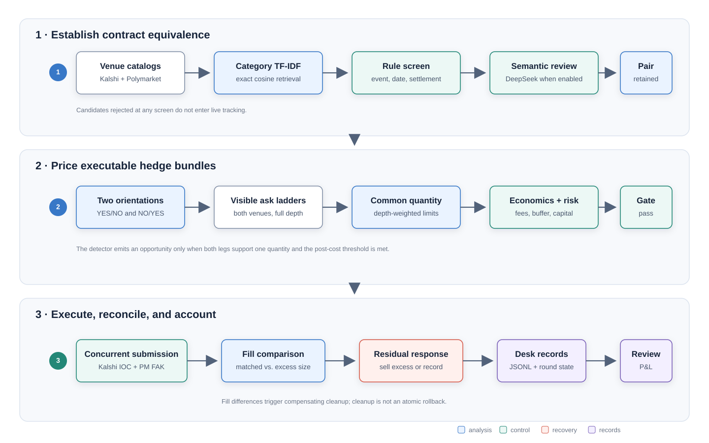
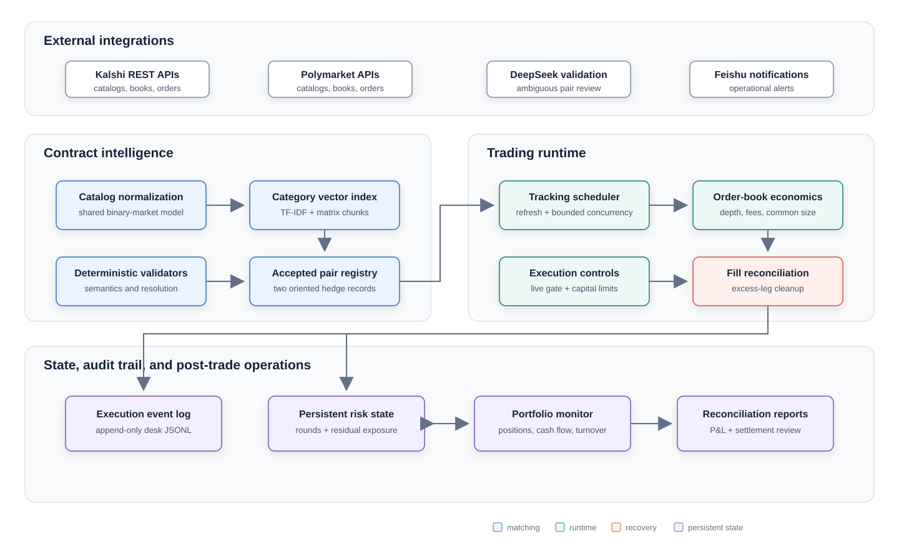

# Cross-Platform Prediction Market Arbitrage System

An event-driven Rust system that matches economically equivalent binary contracts on Kalshi and Polymarket, prices complementary positions from visible order-book depth, and manages the execution and reconciliation of the resulting two-venue trades.

The implementation connects three problems that are often evaluated separately: cross-venue contract equivalence, executable rather than quoted arbitrage economics, and post-trade control of non-atomic fills.

> Research software. Live operation can create positions and move collateral. This repository is not investment advice and does not imply future profitability.

## What the system implements

| Problem | Implemented approach | Where to inspect |
|---|---|---|
| Contract equivalence | Category-specific TF-IDF retrieval, exact cosine search in matrix chunks, deterministic settlement rules, and optional DeepSeek review | [`trader/src/market_matcher.rs`](trader/src/market_matcher.rs), [`trader/src/validation.rs`](trader/src/validation.rs) |
| Executable pricing | Both complementary hedge orientations, full visible ask ladders, common integer sizing, depth-weighted limits, venue fees, and an execution buffer | [`trader/src/arbitrage_detector.rs`](trader/src/arbitrage_detector.rs), [`trader/src/fee_model.rs`](trader/src/fee_model.rs) |
| Two-venue execution | Kalshi immediate-or-cancel and Polymarket fill-and-kill orders launched from one concurrent join point | [`trader/src/kalshi_trade.rs`](trader/src/kalshi_trade.rs), [`trader/src/polymarket_trade.rs`](trader/src/polymarket_trade.rs) |
| Exposure control | Central order gate, capital caps, persistent round limits, returned-fill comparison, excess-leg cleanup, and unresolved-position records | [`trader/src/system_params.rs`](trader/src/system_params.rs), [`trader/src/position_cleanup.rs`](trader/src/position_cleanup.rs) |
| Post-trade accounting | Append-only execution events plus position, cash-flow, turnover, profit, and settlement-reconciliation utilities | [`portfolio_monitor/`](portfolio_monitor/) |

## From two contracts to one hedged payoff

For contracts with aligned resolution rules, the system evaluates both bundles:

```text
Kalshi YES + Polymarket NO
Kalshi NO  + Polymarket YES
```

A complete bundle settles near one dollar. For a common quantity `q`, the pre-trade calculation is:

```text
settlement value = q × $1
all-in cost      = Kalshi ladder cost + Polymarket ladder cost
                   + venue fees + execution buffer
estimated return = settlement value - all-in cost
```

The detector walks the available ask ladders instead of multiplying a top-of-book quote by the requested size. A candidate proceeds only if both legs support the same integer-aligned quantity and the estimated post-cost return clears the configured threshold. The estimate is not a guarantee of fills or settlement outcome.

## Operating workflow



The first lane establishes economic equivalence before a pair reaches active tracking. The second evaluates live liquidity and risk limits. The third separates order submission from fill reconciliation because the venues do not share an atomic transaction boundary.

## Contract intelligence

The matching path is designed for large, heterogeneous market catalogs rather than a fixed hand-maintained pair list.

1. Kalshi and Polymarket listings are normalized into one binary-market representation.
2. Category keywords partition the search space and select category-aware validation rules.
3. TF-IDF vectors are compared with exact bidirectional cosine search in 512-row matrix chunks.
4. Deterministic validators reject mismatched event types, dates, thresholds, participants, rounds, and settlement semantics.
5. When enabled, DeepSeek reviews the remaining ambiguous candidates using a structured accept/reject response.
6. Every retained pair is expanded into the two complementary hedge orientations before tracking.

LLM validation runs while pairs are formed, not after an opportunity reaches the execution path. A failed, timed-out, or unparseable LLM response is rejected rather than treated as approval. See [matching and validation internals](trader/README.md#contract-matching-and-validation).

## Execution and risk framework

| Stage | Checks and response |
|---|---|
| Before sizing | Exclude expired, imminent, date-skewed, or round-limited pairs; fetch both current order books and the relevant fee state |
| Opportunity sizing | Walk both ladders, derive a common quantity and worst acceptable limit prices, include venue-specific fees and the configured execution buffer |
| Capital approval | Apply per-leg and combined-pair fractions of session reference capital, Kalshi deployable-balance limits, and the central live-order permission gate |
| Order submission | Start venue-native Kalshi IOC and Polymarket FAK requests together through `tokio::join!` to avoid intentionally sequencing one leg behind the other |
| Fill reconciliation | Compare returned fill quantities; submit an immediate sell for excess contracts on one venue when possible |
| Failure containment | Persist residual exposure when cleanup is incomplete, preserve successful-round state across restarts, and emit structured desk events for review |
| Session oversight | Compare cash and collateral with startup references, suppress new execution after configured thresholds, and issue optional rebalancing alerts |

Concurrency reduces deliberate inter-leg delay; it does not make the trade atomic. A rejected request, changing order book, venue outage, or partial fill can still leave directional exposure. Cleanup is a compensating trade and may also fail or execute at an unfavorable price.

## Component architecture



The repository separates contract intelligence from the order-capable runtime and keeps portfolio analysis in a second workspace crate. Persistent files provide an audit trail and restart-aware limits, but they are not a transactional database. The detailed module map and state ownership are documented in [Architecture](docs/ARCHITECTURE.md).

## Validation record and evidence boundary

The project was exercised with live venue catalogs, authenticated order paths, reconciliation utilities, and bounded small-capital trading. These observations describe the development scope; they are not performance forecasts.

| Area | Recorded scope | Interpretation boundary |
|---|---|---|
| Catalog ingestion | Configured for approximately 50,000 listings per venue | Capacity setting, not a claim that every listing produced a candidate |
| Similarity stage | Microsecond-level measurements for individual comparison operations during development | Does not include catalog download, vector construction, validation, or network time |
| Retained-pair review | 100% agreement on the manually validated retained-pair sample | Sample-specific result, not accuracy over all possible contracts |
| End-to-end execution | Small-scale completed cycles exercised detection, concurrent submission, fill handling, and portfolio accounting | Private venue records are not published and cannot be independently reconstructed here |
| Completed-cycle outcome | 10%–20% net return on capital deployed in the reported individual cycles | Not annualized and not evidence of repeatability or expected future return |

The public repository exposes implementation paths and record schemas. Credentials, account identifiers, private trade logs, and raw account exports remain excluded.

## Repository guide

```text
.
├── trader/                 # Matching, pricing, execution, risk, and reconciliation
│   └── README.md           # Trader module map and execution invariants
├── portfolio_monitor/      # Position, cash-flow, profit, turnover, and settlement tools
│   └── README.md           # Utility matrix, inputs, and side-effect boundaries
├── config/                 # Matching taxonomy
│   └── README.md           # Category behavior and editing guidance
├── docs/                   # Architecture, configuration, and operating guides
│   └── README.md           # Documentation index and reading paths
├── COMMANDS.md             # Build and command reference
└── SECURITY.md             # Credential and disclosure guidance
```

Start with the path that matches the question:

- **Research and matching:** [Trader internals](trader/README.md#contract-matching-and-validation)
- **Execution and exposure:** [Trader execution path](trader/README.md#execution-path-and-invariants)
- **Architecture and state:** [Architecture](docs/ARCHITECTURE.md)
- **Credentials and controls:** [Configuration](docs/CONFIGURATION.md)
- **Preflight and recovery:** [Operations](docs/OPERATIONS.md)
- **Portfolio and settlement:** [Portfolio monitor](portfolio_monitor/README.md)
- **Runnable commands:** [Command reference](COMMANDS.md)

## Build and inspect safely

Rust stable is required. Compile and test the workspace before connecting accounts:

```bash
cargo build --workspace --release
cargo test --workspace
cargo run -p trader --bin check_env --release
```

`check_env` validates credential presence and selected connectivity without starting the trading loop. The main binary is not a simulation command:

```bash
cargo run -p trader --release
```

The checked-in source currently sets `LIVE_TRADING_ON = true`, and startup copies that value directly into the runtime order gate. There is no second interactive confirmation. Review [Configuration](docs/CONFIGURATION.md) and [Operations](docs/OPERATIONS.md) before invoking the main binary.

## Technology and implementation choices

- Rust 2021 and Tokio for asynchronous scheduling and bounded concurrent work
- `ndarray` for vectorized, chunked cosine-similarity calculations
- `reqwest` for market-data and authenticated HTTP integrations
- RSA-PSS request signing for Kalshi
- Polymarket CLOB SDK and Alloy signing components
- JSONL event records with CSV and PNG portfolio outputs

## Known boundaries

- Similar language and high cosine similarity do not prove identical settlement rules.
- Visible liquidity can change between detection and execution; hidden liquidity and queue position are not modeled.
- Immediate-or-cancel behavior limits resting orders but does not guarantee balanced fills.
- The LLM stage depends on an external service and uses rejection as its failure default.
- File-backed events and counters support traceability but not distributed or transactional recovery.
- Venue APIs, fees, collateral conventions, access rules, and resolution processes can change independently.
- The repository contains no public historical backtest, latency benchmark, or independently auditable profitability record.

## License

No open-source license has been declared. The repository is publicly viewable, but reuse rights are not granted unless the owner adds a license.
